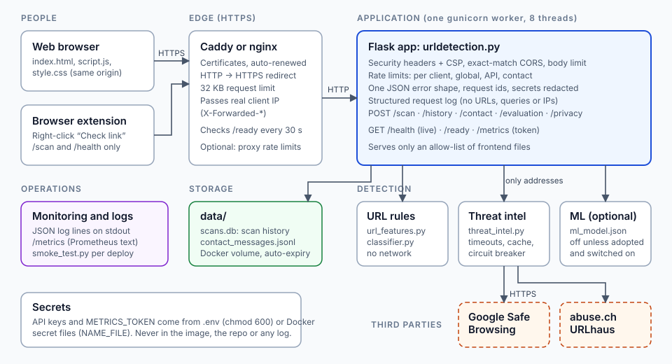

# LinkLens

Paste a link, get a verdict with the evidence behind it. Flask backend, plain HTML/CSS/JS frontend, and a browser extension
that checks links from the right-click menu.

## At a glance

| | |
| --- | --- |
| **What it is** | A link checker. You paste an address, it returns one of four verdicts with the evidence behind it. It never opens the link. |
| **Pieces** | Flask backend (also serves the page), plain HTML/CSS/JS frontend, Chromium browser extension, optional evidence-gated ML model. |
| **Status** | A working, tested prototype with deployment files. Not an audited security product (see [Security and privacy](#security-and-privacy)). |
| **Verdict sources** | Google Safe Browsing and abuse.ch URLhaus (confirmed threats) plus URL-structure rules (warnings). |

## Architecture



A scan, step by step: the browser (or the extension) sends `POST /scan` → HTTPS is terminated by the proxy (or by Render) → the app
checks the origin, size, content type and rate limits → `classify_url` parses the address (no network), asks the threat
databases in parallel with a hard deadline, and combines everything into a verdict → the app saves a privacy-trimmed copy
to this browser's history (not for extension checks) → it answers JSON. A failed lookup is reported as a failure, never as "clear".

## Quick start (your own machine)

```
python -m pip install -r requirements.txt
cp .env.example .env         # then add your keys; on Linux/macOS also: chmod 600 .env
python urldetection.py       # local development only: http://127.0.0.1:5000
```

Prerequisites: Python 3.12 (what it was developed and tested on; older 3.x may work but is untested) . Without API keys the app still runs; results are then "Unable to verify" or "Suspicious", never "No known threat".

## Deploy it (Render: the quickest public demo)

`python urldetection.py` is Flask's development server and is for your own machine only. To put the app on the internet over HTTPS:

1. Push the project to a GitHub repository (`.env` and the local databases are git-ignored).
2. In Render choose **New → Blueprint** and select the repository. [`render.yaml`](render.yaml) defines the service.
3. When asked, enter `GOOGLE_SAFE_BROWSING_API_KEY` (and optionally `URLHAUS_AUTH_KEY`), and set `CORS_ORIGINS` to
   `https://<your-service>.onrender.com`. Render provides the domain and the HTTPS certificate; `METRICS_TOKEN` is generated for you.
4. When it is live, prove it works:
   ```
   python tools/smoke_test.py https://<your-service>.onrender.com --expect-intel
   ```

Know the limits: free instances sleep when idle (the first scan after a pause is slow) and have **no persistent disk**, so scan
history and contact messages reset on every deploy or restart. That is fine for a demonstration; for a demo turn the contact form off
with `CONTACT_ENABLED=0`. The blueprint has not been run on Render from here, so check its field names against Render's current
blueprint reference if the import complains.

**Prefer your own server?** Docker Compose with Caddy (automatic HTTPS) and a plain VM with systemd and nginx are optional alternatives.
Both, plus secrets, logging, monitoring, rate limits, backups, a production checklist and troubleshooting, are in
[`docs/DEPLOYMENT.md`](docs/DEPLOYMENT.md).

## Browser extension

`extension/` is a Chromium (Chrome, Edge, Brave) extension that adds **Check link with Cyber Solutions** to the right-click menu, so a
link can be checked without leaving the page. It reuses this backend (`POST /scan`), asks for two permissions (`contextMenus`, `storage`),
talks only to the one server you choose, and checks nothing you did not pick. Install steps, permissions and safety rules are in
[`extension/README.md`](extension/README.md).

Quick start: run the server, open `chrome://extensions`, turn on **Developer mode**, choose **Load unpacked**, select the `extension` folder.
To use it with a deployed server, open the extension's **Settings** and enter that server's address.

## API

| Endpoint | Purpose |
| --- | --- |
| `POST /scan` `{"url": "..."}` | Scan a link. Returns `verdict`, `verdict_code` (`malicious` / `suspicious` / `no_known_threat` / `unable_to_verify`), `confirmed`, `severity`, `summary`, `evidence[]`, `sources[]`, `risk_score`, `basis`, `scanned_at`. |
| `GET /history`, `GET /history/export`, `DELETE /history[/<id>]` | This browser's saved scans: list with filters and dashboard stats, download as CSV or JSON, delete one or all. |
| `POST /contact` | Send a message (stored only with an explicit consent flag). |
| `GET /privacy`, `GET /evaluation` | What this server stores and sends; the latest measured accuracy of the rules. |
| `GET /health`, `GET /ready`, `GET /metrics` | Liveness, readiness, and Prometheus metrics (404 unless `METRICS_TOKEN` is set). |

Errors always look like `{"error": "...", "code": "...", "request_id": "..."}`; the request id matches a line in the server log.
Every parameter, filter and response field is in the [API reference](docs/DEVELOPMENT.md#api).

## Security and privacy

* **Never opens a link.** Addresses are parsed and sent to the threat databases only; private and local addresses are refused.
* **Strict by default:** exact-match CORS, 16 KB body cap, JSON-only requests, per-address and global rate limits, one error shape
  with no stack traces, a strict Content-Security-Policy, and an explicit list of the only files served.
* **Secrets** live in `.env` (git-ignored) or in files (`*_FILE`), travel in headers never URLs, and are redacted from logs.
* **Private history:** per-browser via an anonymous cookie (only its hash is stored), deleted after 30 days by default, removable any time.
  Logs never contain scanned addresses, query strings, cookies or client IPs.
* **Honest limits:** no user accounts, no database encryption at rest, third-party lookups see scanned addresses (unless you set
  `THREAT_INTEL_SEND_QUERY=0`), and this is a student project with tests and a self-review, **not an independent security audit**.

The full protection table, the complete list of what it does **not** do, and the privacy details are in
[`docs/DEVELOPMENT.md`](docs/DEVELOPMENT.md#security); the self-review is [`reports/security_review.md`](reports/security_review.md).

## More documentation

| | |
| --- | --- |
| [`docs/DEPLOYMENT.md`](docs/DEPLOYMENT.md) | Every deployment route, secrets, logging, monitoring, rate limits, backups, checklist, troubleshooting |
| [`docs/DEVELOPMENT.md`](docs/DEVELOPMENT.md) | Testing, every setting, full API reference, security and privacy, file layout, how accuracy is measured |
| [`docs/ML.md`](docs/ML.md) | The optional ML model: how it was tested and why it is **not** adopted |
| [`reports/evaluation_report.md`](reports/evaluation_report.md) | Measured accuracy of the URL rules (heuristics only; synthetic phishing rows, so read the limits) |
