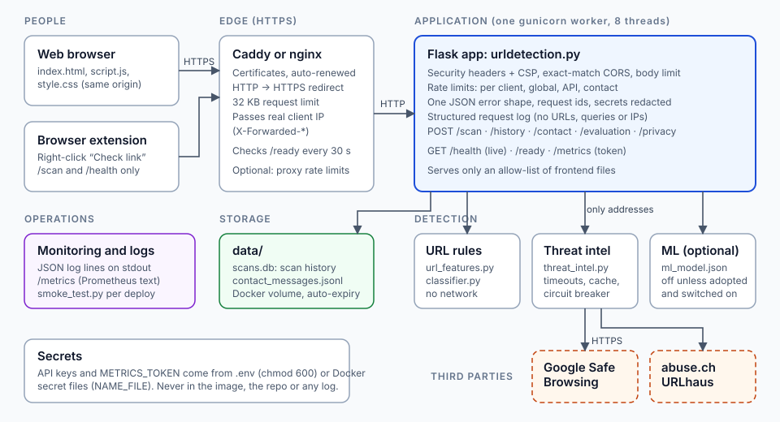

# Deployment guide

How to put Cyber Solutions on the internet over HTTPS, keep it healthy, and prove it works. The app is one Flask
service that also serves the web page, so there is a single thing to deploy.



Pick one route. **Route C (Render) is the primary path** used in the [README](../README.md); A and B are optional alternatives for a
server you control.

| Route | Best for | HTTPS from |
| --- | --- | --- |
| **C. Render blueprint** (primary) | A quick public demo with no server to manage | Render |
| **A. Docker Compose + Caddy** | Any VM or VPS you control; the best choice if you need persistent history | Caddy (automatic, renews itself) |
| **B. Plain VM: systemd + nginx** | A server without Docker | nginx + certbot |

Routes A and B were not run on a real server while this guide was written. The smoke test in step 4 of each is how you
confirm yours works; it is the first thing to run, and the thing to re-run after every update.

---

## What you need first

* A **domain name** pointing at your server (an `A`/`AAAA` record). HTTPS certificates are issued to names, not bare IPs.
* Ports **80 and 443** open to the internet (Caddy needs 80 for the certificate challenge).
* A **Google Safe Browsing API key** (free, see `.env.example`). Without one every scan ends as "Unable to verify" or
  "Suspicious" and the landing page says so. A URLhaus key is optional.

---

## Route A: Docker Compose + Caddy

```bash
git clone <your repo> cyber_solutions && cd cyber_solutions

cp deploy/production.env.example .env
chmod 600 .env                      # the file holds secrets
nano .env                           # set DOMAIN=..., GOOGLE_SAFE_BROWSING_API_KEY=..., and a METRICS_TOKEN

docker compose up -d --build
docker compose ps                   # both services should become "healthy" / "running"
docker compose logs -f app          # JSON log lines; startup warnings appear first
```

What `docker-compose.yml` sets for you, and why:

| Setting | Reason |
| --- | --- |
| `TRUSTED_PROXY_COUNT=1` | Caddy is the one proxy in front. The app then believes `X-Forwarded-For/-Proto` and sees each visitor's real address, so rate limits are per visitor and cookies get the `Secure` flag. With `0` every visitor looks like Caddy. |
| `HSTS=1`, `COOKIE_SECURE=1` | Browsers insist on HTTPS; the history cookie never travels over plain HTTP. |
| `CORS_ORIGINS=https://$DOMAIN` | Only your own origin may call the API from a browser. |
| `read_only`, `cap_drop: ALL`, `no-new-privileges`, non-root user | A compromised process can change very little. |
| Only Caddy publishes ports | The app is not reachable except through the proxy. |
| `appdata` volume on `/app/data` | Scan history and contact messages survive redeploys. |
| `caddy_data` volume | Keeps the certificate. Deleting it repeatedly can hit Let's Encrypt's rate limits. |

### Step 4: prove it works

From any machine (your laptop is fine):

```bash
python tools/smoke_test.py https://your.domain --expect-intel --metrics-token "$METRICS_TOKEN"
```

Everything should pass. `--expect-intel` fails if no threat database answered, which is the check that your API key and
the server's outbound network work. Add `--rate-limit-test` as a last run to see HTTP 429 and `Retry-After` (it uses up your
address's scan allowance for about a minute).

### Updating and rolling back

```bash
git pull && docker compose up -d --build        # rebuilds; in-flight scans get 30 s to finish
python tools/smoke_test.py https://your.domain  # always re-check
```

Rollback: `git checkout <previous commit>` and run the same `docker compose up -d --build`.

### Backups

Only `data/` holds state. To copy it out (volume name is `<folder>_appdata`; check with `docker volume ls`):

```bash
docker run --rm -v cyber_solutions_appdata:/d -v "$PWD":/b alpine tar czf /b/appdata-$(date +%F).tgz -C /d .
```

Backups contain contact messages (names, emails). Protect them like the live data, and remember they outlive the
app's automatic deletion: delete old backups on the same schedule as `CONTACT_RETENTION_DAYS`.

### Keeping keys out of the environment (optional)

Instead of `GOOGLE_SAFE_BROWSING_API_KEY=` in `.env`, create `secrets/gsb_key` (one line, `chmod 600`), uncomment the
`secrets` lines in `docker-compose.yml`, and set `GOOGLE_SAFE_BROWSING_API_KEY_FILE=/run/secrets/gsb_key`. `URLHAUS_AUTH_KEY_FILE`
and `METRICS_TOKEN_FILE` work the same way.

---

## Route B: plain VM (systemd + nginx)

```bash
sudo useradd --system --home /opt/cyber_solutions --shell /usr/sbin/nologin cs
sudo git clone <your repo> /opt/cyber_solutions && cd /opt/cyber_solutions
sudo python3 -m venv .venv && sudo .venv/bin/pip install -r requirements-prod.txt
sudo cp deploy/production.env.example .env && sudo chmod 600 .env && sudo chown cs: .env
sudo mkdir -p data && sudo chown cs: data && sudo chmod 700 data
```

Edit `.env`: remove `DOMAIN`, and add `APP_ENV=production`, `TRUSTED_PROXY_COUNT=1`, `HSTS=1`, `COOKIE_SECURE=1`,
`CORS_ORIGINS=https://your.domain`, plus your keys. Then `/etc/systemd/system/cyber-solutions.service`:

```ini
[Unit]
Description=Cyber Solutions
After=network.target

[Service]
User=cs
WorkingDirectory=/opt/cyber_solutions
EnvironmentFile=/opt/cyber_solutions/.env
Environment=BIND=127.0.0.1:8000 LOG_FORMAT=json
ExecStart=/opt/cyber_solutions/.venv/bin/gunicorn -c gunicorn.conf.py wsgi:app
Restart=on-failure
NoNewPrivileges=true
ProtectSystem=strict
ReadWritePaths=/opt/cyber_solutions/data
PrivateTmp=true

[Install]
WantedBy=multi-user.target
```

```bash
sudo systemctl daemon-reload && sudo systemctl enable --now cyber-solutions
journalctl -u cyber-solutions -f
```

Put nginx in front using `deploy/nginx.conf.example` (it includes proxy-level rate limits), get a certificate with
`sudo certbot --nginx -d your.domain`, run `sudo nginx -t && sudo systemctl reload nginx`, then run the smoke test as in Route A.

---

## Route C: Render

`render.yaml` is a blueprint for one web service. In Render choose **New → Blueprint**, point it at the repo, and when
asked fill in `GOOGLE_SAFE_BROWSING_API_KEY` and `CORS_ORIGINS` (`https://<service>.onrender.com`). Render supplies HTTPS.

Know the limits: free instances sleep when idle (the first scan after a pause is slow) and have **no persistent disk**,
so scan history and contact messages disappear on each deploy or restart. That is fine for a demonstration, not for
collecting real contact messages (turn the form off with `CONTACT_ENABLED=0`). The blueprint's field names were written
from memory of Render's format; check them against Render's current blueprint reference if the import complains.

---

## Logging

* The app writes **one JSON line per request** to stdout: `ts, level, msg, request_id, method, path, status, duration_ms`.
  `path` is the matched route pattern (`/history/<int:scan_id>`), never the raw URL or query string. Scanned addresses, cookies
  and client IPs are not logged. Health checks are logged only at `LOG_LEVEL=DEBUG`.
* Every error response carries a `request_id`; search the log for it to find the traceback.
* Startup warnings (missing API key, `TRUSTED_PROXY_COUNT=0`, HSTS off) appear when `APP_ENV=production`.
* **Your proxy logs differ.** Caddy's and nginx's access logs include client IPs and URL paths with query strings. Set a short
  retention for them and mention them in your privacy text. Gunicorn's own access log is off unless `GUNICORN_ACCESSLOG=1`.

## Monitoring

| Endpoint | Meaning | Use it for |
| --- | --- | --- |
| `GET /health` | The process is up | Liveness probe, uptime monitors |
| `GET /ready` | History and contact files are writable (503 if not) | Load balancer / Caddy health check |
| `GET /metrics` | Prometheus text. **404 unless `METRICS_TOKEN` is set**, and 404 for a wrong token | Prometheus, Grafana Agent |

Prometheus scrape example:

```yaml
scrape_configs:
  - job_name: cyber-solutions
    scheme: https
    metrics_path: /metrics
    authorization: { type: Bearer, credentials: "<METRICS_TOKEN>" }
    static_configs: [{ targets: ["your.domain"] }]
```

Counters: `cs_requests_total{route,status}`, `cs_scan_verdicts_total{verdict}`, `cs_rate_limited_total`,
`cs_lookup_failures_total`, `cs_request_duration_seconds_sum/_count`, `cs_process_start_time_seconds`. Useful alerts:

* `rate(cs_lookup_failures_total[10m]) / rate(cs_scan_verdicts_total[10m]) > 0.2`: a threat database is failing or your key was revoked/over quota.
* `rate(cs_requests_total{status="5xx"}[5m]) > 0`: server errors.
* `rate(cs_rate_limited_total[5m])` sustained high: abuse, or limits too low for real use.
* An external uptime check on `/health` (UptimeRobot, Better Stack, a cron job running the smoke test).

Counters are per process and reset on restart. The default of one worker keeps them exact; see below.

## Rate limits

Set in `.env` (per client address per minute): `RATE_LIMIT_PER_MINUTE` (scans, default 30), `API_RATE_LIMIT_PER_MINUTE` (120),
`CONTACT_RATE_LIMIT_PER_MINUTE` (5), and `GLOBAL_RATE_LIMIT_PER_MINUTE` (600, all clients together: it protects your
Safe Browsing quota). Limits live in process memory, which is why `gunicorn.conf.py` defaults to **one worker with eight
threads**: with several workers each keeps its own counters and the effective limit is multiplied. If you raise
`WEB_CONCURRENCY`, also rate-limit at the proxy (`deploy/nginx.conf.example` shows how).

## Production checklist

- [ ] DNS points at the server; `https://your.domain` loads with a valid certificate; `http://` redirects.
- [ ] `.env` is `chmod 600`, not in git, not in the image (`docker compose exec app ls -a /app` shows no `.env`).
- [ ] `APP_ENV=production`, `TRUSTED_PROXY_COUNT=1`, `HSTS=1`, `COOKIE_SECURE=1`, `FLASK_DEBUG=0`; **no startup warnings** in the log.
- [ ] A threat-database key is set and `tools/smoke_test.py ... --expect-intel` passes.
- [ ] `METRICS_TOKEN` is long and random (or unset to switch metrics off); `/metrics` returns 404 without it.
- [ ] Your API key is restricted in Google Cloud to the Safe Browsing API (and your server's IP if fixed).
- [ ] Backups of the `data` volume exist and old ones are deleted on the retention schedule.
- [ ] The privacy page (`#/privacy`) matches reality, including the proxy's access logs.
- [ ] Smoke test is part of every release.

## Troubleshooting

| Symptom | Likely cause |
| --- | --- |
| Caddy cannot get a certificate | DNS not pointing here yet, or ports 80/443 blocked. `docker compose logs caddy` says which. |
| Landing page says "no threat database is set up" | API key empty or wrong variable name. Check `docker compose logs app` for the startup warning. |
| Every visitor gets 429 together | `TRUSTED_PROXY_COUNT=0` behind a proxy: all requests appear to come from the proxy. |
| History does not persist / "not ready" | The data directory is not writable by the app user. `/ready` returns 503 and names `history_store`. |
| Cookie never sticks | `COOKIE_SECURE=1` while testing over plain HTTP. Test over HTTPS. |
| `/metrics` is 404 | Intentional until `METRICS_TOKEN` is set and sent as `Authorization: Bearer <token>`. |
| Scans slow (many seconds) | A threat database is timing out; see `THREAT_INTEL_*` in `.env.example`. Failed lookups are never reported as clear. |
